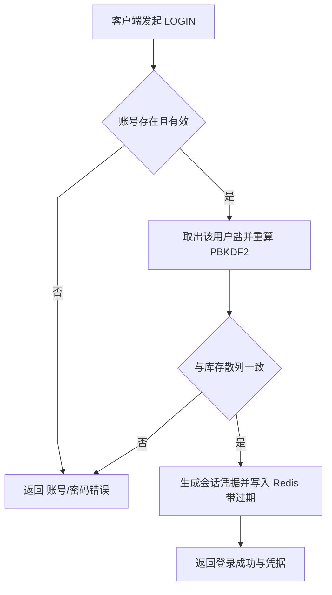
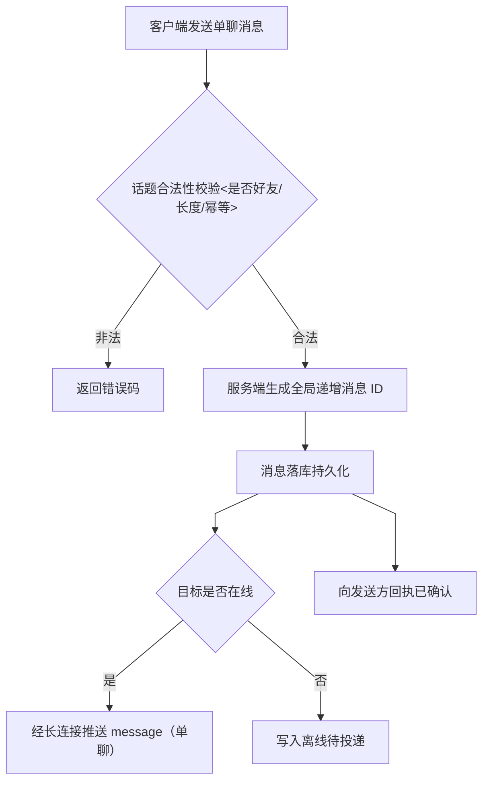
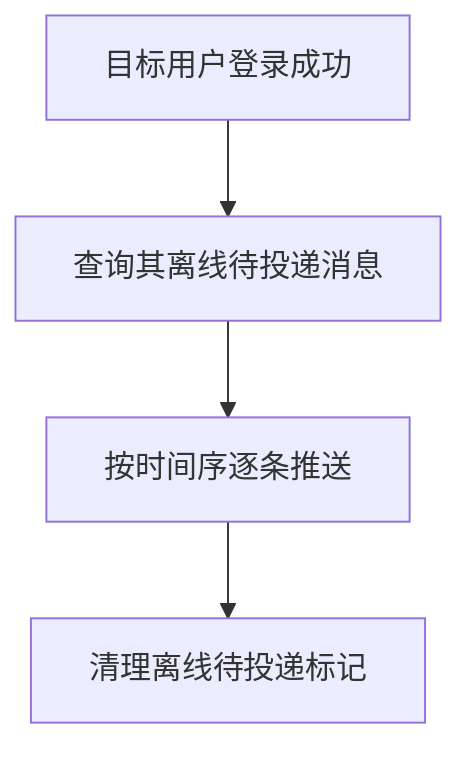

# 产品需求文档（PRD · Product Requirements Document）

> 阶段：2 / 9 — 需求定义
> 项目：EmberIM 即时通讯服务端
> 定位：C/S 架构下的实时通讯服务端（多线程 Reactor + TCP 长连接 + 请求-响应 + 实时推送）
> 读者：研发 / 测试 / 学习读者。本文档是功能、用户故事与业务规则的**唯一基准**。

---

## 1. 引言与项目定位

EmberIM 是一个**可落地的即时通讯服务端**，学习用但要求架构完整、可编译、可运行。它属于 **C/S 架构**：客户端为独立安装的 IM 客户端（App/桌面程序，本仓库只实现**服务端**），双方通过**自定义 TCP 长连接协议**通信。

服务端职责：接收并维护大量客户端长连接，处理注册/登录/好友/群组/单聊/群聊/历史/在线等业务，负责消息的**路由、持久化与实时推送**。

## 2. 用户角色与使用场景

### 2.1 角色
- **普通用户**：注册、登录、加好友、建群、单聊/群聊、看历史、收离线消息、感知好友在线状态。
- **（内部）系统运维者**：单机部署、启动服务、配置环境变量、应对异常。

### 2.2 用户故事（核心场景）
- US1 用户 A 注册账号，随后登录，获得会话凭据。
- US2 用户 A 添加用户 B 为好友，B 同意后成为双向好友。
- US3 A 向 B 发送单聊消息；B 在线则即时收到，B 离线则上线后按序补收。
- US4 A 创建群组并拉人入群，群内消息群发。
- US5 任意用户按时间倒序分页拉取某个会话（单聊/群聊）的历史消息。
- US6 好友上线/下线时，对方向其好友广播在线状态变化。
- US7 客户端心跳保活；服务端对超时连接主动断开。
- US8 服务端收到终止信号时排空连接、刷盘落库后优雅退出。
- US9 用户 A 按用户名搜索到用户 B，查看资料后发起加好友申请；B 在「好友申请列表」中处理；A 可修改自己的昵称/签名，名片随之刷新。
- US10 用户查看「最近会话列表」与未读数；读取某会话后该会话未读数清零。

## 3. 名词与术语

| 术语 | 含义 |
| :--- | :--- |
| 会话（Conversation） | 单聊：一个用户与另一个用户；群聊：一个群组。历史消息按会话组织 |
| 在线状态 | 服务端维护的用户当前是否持有存活长连接 |
| 离线补推 | 用户离线期间产生的消息先落库，其上线后按序补发给该用户 |
| 游标分页 | 以「某条消息/时间戳」为游标向后翻页，避免偏移量分页在实时插入下失效 |
| 幂等 | 同一 `client_msg_id` 的重复请求不产生重复业务结果 |
| 客户端消息 ID | 客户端为去重/幂等生成的唯一标识（client_msg_id） |
| 最近会话 | 用户所有会话（单聊/群聊）按最近活跃时间倒序的聚合视图 |
| 未读数 | 用户在某个会话中尚未读取的消息条数 |

## 4. MVP 功能总览

| 编号 | 功能 | 优先级 | 一句话说明 |
| :--- | :--- | :--- | :--- |
| F1 | 注册 | P0 | 创建账号，生成密码散列与会话凭据 |
| F2 | 登录 | P0 | 校验口令，下发会话凭据 |
| F3 | 登出 | P0 | 使会话凭据失效 |
| F4 | 会话校验与心跳 | P0 | 鉴权、保活、超时踢出 |
| F5 | 加好友 | P0 | 发起申请、对方同意/拒绝、双向好友 |
| F6 | 好友列表 | P0 | 查询我的双向好友 |
| F7 | 删除好友 | P0 | 单方面删除，双向移除 |
| F8 | 建群 | P0 | 创建群组，创建者为群主 |
| F9 | 拉人入群 / 退群 | P0 | 群主或成员增删群成员 |
| F10 | 群列表 / 群成员列表 | P0 | 查询我加入的群与群成员 |
| F11 | 单聊消息 | P0 | 私有会话发送与实时/离线接收 |
| F12 | 群聊消息 | P0 | 群内消息群发与实时/离线接收 |
| F13 | 历史消息分页 | P0 | 会话历史倒序游标分页 |
| F14 | 离线消息补推 | P0 | 离线消息落库，上线后按序补发 |
| F15 | 在线状态广播 | P0 | 好友上线/下线实时通知 |
| F16 | 登录限流 | P0 | 登录失败计数限速，防爆破 |
| F17 | 优雅关闭 | P0 | SIGINT/SIGTERM 排空连接→落库→退出 |
| F18 | 搜索用户 / 用户资料 | P0 | 按用户名搜索用户，查看资料，发起加好友前置 |
| F19 | 更新个人资料 | P0 | 修改昵称/头像/个性签名 |
| F20 | 好友申请列表 | P0 | 查看待我处理的好友申请（同意/拒绝） |
| F21 | 最近会话与未读数 | P0 | 会话列表（末条预览）+ 未读数查询与清除 |

> 优先级：P0 为本期必做；P1 为增强（本期不做，列入后续）。

## 5. 详细功能需求（功能 / 业务规则 / 验收标准）

### F1 注册
- **业务规则**：用户名 8–32 字符且仅由英文字母与数字组成（a-z A-Z 0-9），全局唯一；口令 8–64 字符，字符集仅限 ASCII 可打印字符（英文字母/数字及常见符号），至少含 1 个字母与 1 个数字；禁止非 ASCII 字符、空格、制表符/换行/回车等空白与控制字符（**服务端强制**）；口令+随机盐经 PBKDF2-HMAC-SHA256 生成散列；**明文口令绝不落盘/不进日志/不回显**；口令仅经 TLS 一次性传输，服务端校验长度/强度；**两次确认在客户端完成**，服务端仅接收一个口令字段；注册成功即签发会话凭据（自动登录）。
- **验收标准**：① 新用户名注册成功并可登录；② 重复用户名被拒绝且返回明确错误码；③ 用户名长度（<8 或 >32）或含非法字符（非英文字母/数字），或口令长度/强度（<8、>64、缺字母或数字、含非 ASCII、含空格/制表/换行等空白与控制字符）不符均被拒并返回对应错误码；④ 数据库中仅存散列与盐，检索不到明文；⑤ 日志无明文口令。

### F2 登录
- **业务规则**：按用户名取该用户盐重算散列比对；口令长度超上限（>64）直接拒绝（上限为硬约束）；连续失败超过阈值触发限流；成功后用 CSPRNG 生成会话凭据（token），写入 Redis 带过期，客户端仅持 token。
- **验收标准**：① 正确口令登录成功并返回 token；② 错误口令被拒并返回对应错误码；③ 高频失败被限流；④ token 过期后被拒绝。

### F3 登出
- **业务规则**：使当前 token 失效（Redis 删除/置失效）；服务端认为该会话登出。
- **验收标准**：登出后原 token 无法再通过鉴权。

### F4 会话校验与心跳
- **业务规则**：所有非注册/登录命令需携带有效 token；客户端定时发送心跳（HEARTBEAT）；服务端对超过 `heartbeat_timeout`（默认 **60s**，可配）未活跃的连接判定超时并断开；心跳可顺带续期。
- **验收标准**：① 无有效 token 的请求被拒；② 正常心跳下连接保持；③ 停止心跳超过超时阈值后服务端主动断开该连接并广播离线。

### F5 加好友
- **业务规则**：需**对方同意**双向确认；发起方身份须已登录；不得重复申请同一对象；可同意或拒绝未处理申请。
- **验收标准**：① A 申请 B，B 未处理时 A/B 均看到待处理状态；② B 同意后 A、B 双向成为好友且出现在彼此好友列表；③ B 拒绝则关系不建立；④ 重复申请被拒绝。

### F6 好友列表
- **业务规则**：返回当前用户全部双向好友及其最新昵称/头像/在线状态。
- **验收标准**：好友列表正确、含在线状态字段；与好友关系实时一致。

### F7 删除好友
- **业务规则**：单方面删除，**双向移除**好友关系；撤销相关的单向好友申请（若存在）。
- **验收标准**：A 删除 B 后，A、B 的好友列表互不再出现对方。

### F8 建群
- **业务规则**：创建者即**群主**；群名、可选群公告；群主可解散群。
- **验收标准**：建群成功并出现在创建者的群列表；返回群信息与群主角色。

### F9 拉人入群 / 退群
- **业务规则**：群主可拉人入群（无需审核）与移出成员；成员可自愿退群；被移出者收到通知。
- **验收标准**：拉人后对方出现在群成员列表；移出/退群后成员列表与群消息权限实时一致。

### F10 群列表 / 群成员列表
- **业务规则**：返回我加入的群列表；返回某群的成员列表（含角色）。
- **验收标准**：列表与实际成员关系一致。

### F11/F12 单聊 / 群聊消息
- **业务规则**：
  - 线上实现由**统一 `send_message`** 承载（单聊/群聊以 `conv_type` 区分），见 `contract.yaml`。
  - 消息体上限 **4096 字节**，超限拒发并返回错误码。
  - 客户端带 `client_msg_id`，服务端据此**去重、幂等**，重试不产生重复消息。
  - 服务端生成**全局递增消息 ID**，作为排序/游标依据。
  - 服务端**确认接收即持久化**（落库），避免丢失。
  - 服务端**不解析/不执行 HTML**（仅长度与字符校验后存取，原样下发）；**防 XSS 由客户端展示层负责**。
  - 发送前校验：单聊须为好友；群聊须为该群成员。
- **验收标准**：① 合法消息发送成功；② 接收方在线即实时收到；③ 离线先落库、上线后按序补收；④ 重复 `client_msg_id` 只产生一条消息；⑤ 超长消息拒发；⑥ 非好友/非群成员拒发并返回错误码；

### F13 历史消息分页
- **业务规则**：按会话拉取；**倒序 + 游标分页**（以某消息 ID 为游标向前翻），默认每页 **50** 条，客户端可指定；翻页不超过消息总数。
- **验收标准**：① 分页正确、无重复无遗漏；② 边界（第一页/最后一页/空会话）行为正确；③ 与实时插入的消息不冲突。

### F14 离线消息补推
- **业务规则**：目标离线期间产生的单聊/群聊消息**先落库**；目标**上线后按序补推**一次；补推后清理离线待推标记（可按会话批量）。
- **验收标准**：① 离线期间的消息，上线后按时间序完整补收；② 已在线的消息不重复补；③ 补推完成后不再重复下发。

### F15 在线状态广播
- **业务规则**：用户登录→`friend_online` 推给其好友；用户登出/超时→`friend_offline` 推给其好友；状态进 Redis。
- **验收标准**：好友端能正确收到对方上线/下线通知；状态与服务端连接生命周期一致。

### F16 登录限流
- **业务规则**：按「用户/IP + 时间窗口」对失败登录计数，超阈值则按窗口锁定并拒绝。
- **验收标准**：连续失败达阈值后拒绝尝试，窗口结束后恢复；正常登录不受影响。

### F17 优雅关闭
- **业务规则**：收到 SIGINT/SIGTERM 后：停止接受新连接→通知/排空既有连接→刷新待持久化数据→有序释放资源→退出；可设置关闭超时。
- **验收标准**：发送终止信号后进程退出前的响应与已落库消息完整，进程正常结束，无核心转储。

### F18 搜索用户 / 用户资料
- **业务规则**：按用户名精确匹配（用户名全局唯一）搜索；返回匹配用户的公开资料（用户名/昵称/头像/在线状态）；**不返回**任何口令/散列/敏感字段；搜索者须已登录；支持空结果返回。
- **验收标准**：① 按用户名能搜到用户并返回公开资料；② 搜不到返回空结果与提示；③ 响应不含口令/散列等敏感字段。

### F19 更新个人资料
- **业务规则**：可修改昵称/头像标识/个性签名；昵称 1–32 字符、签名 0–128 字符，非法或超长拒绝；更新后其好友列表、群成员列表、最近会话中展示的名片同步刷新。
- **验收标准**：① 修改成功后相关列表展示新值；② 超长/非法被拒；③ 其他用户可见更新后的资料。

### F20 好友申请列表
- **业务规则**：返回待我处理的申请（发起人/状态/时间），支持同意或拒绝；处理后从待处理列表移除；重复处理被拒绝。
- **验收标准**：① 列表仅含待处理项且状态正确；② 处理后该项被移除；③ 重复同意/拒绝被拒。

### F21 最近会话与未读数
- **业务规则**：按会话聚合最近一条消息预览 + 未读数（单聊/群聊）；按最近活跃时间倒序；支持查询总未读数；**读取某会话后清除对应未读数**；未读数存于 Redis，会话聚合可由历史最新一条生成。
- **验收标准**：① 会话列表按最近活跃倒序，含末条预览与未读数；② 读会话后未读数清零；③ 新消息到来未读递增；④ 在线/离线均正确累计。

## 6. 本期不做清单（后续）

- 消息已读回执、消息撤回/删除、消息搜索
- 文件/图片/语音/视频、端到端加密
- 多端同步、移动推送通道（APNs/FCM）
- Websocket / Web 客户端网关
- 修改群信息/群公告（建群一次性设定，调整功能列后续）
- 黑名单（拉黑用户）
- 修改密码 / 忘记密码（需邮箱/短信验证）
- 多机集群、水平扩展、读写分离、消息队列中间件

> 以上为边界说明；若后续要纳入，须经确认并相应调整本文档与阶段 3+ 设计。

## 7. 业务规则汇总（本阶段确认的默认值）

| 规则 | 结论 |
| :--- | :--- |
| 加好友 | 需对方同意，双向确认；删除好友双向移除 |
| 离线消息 | 离线先落库，上线后按序补推一次 |
| 建群/群管 | 创建者=群主，拉人无需审核，群主可踢人/解散；群消息所有人可见 |
| 消息幂等 | 以 `client_msg_id` 去重 |
| 消息体上限 | 4096 字节 |
| 历史分页 | 倒序、游标，默认每页 50 条 |
| 消息内容安全 | 服务端不解析 HTML，仅存取转发；防 XSS 由客户端展示层负责 |
| 用户名规则 | 8–32 字符且仅英文字母与数字，全局唯一 |
| 密码规则 | 8–64 字符，ASCII 可打印（含常用符号），至少 1 字母+1 数字（服务端强制）；禁止非 ASCII、空格/制表/换行等空白与控制字符；两次确认归客户端 |
| 搜索/资料 | 按用户名精确搜索；资料不含敏感字段；资料修改后各列表名片同步刷新 |
| 好友申请 | 以「待我处理」列表呈现；同意/拒绝后从列表移除；重复处理拒绝 |
| 最近会话/未读 | 按最近活跃倒序聚合末条预览+未读数；读会话清未读；未读存 Redis |
| 资料字段 | 昵称 1–32 字符、签名 0–128 字符；非法/超长拒绝 |
| 心跳超时 | 服务端默认 60s 未活跃即断开（可配） |

## 8. 非功能需求

- **性能**：单实例承载 ≥1000 长连接；并发消息 ≥2000 条/秒；本机 P99 延迟 <50ms（复用阶段 1 基线）。**实测达标**：本机 C++ 压测约 2.5 万条/s、P99≈40ms（见 test-plan 第 11 节）。
- **可靠性**：服务端**确认接收即持久化**；消息不因主动断开而丢失；异常路径有明确错误码。
- **安全**：PBKDF2-HMAC-SHA256 + 逐用户盐；CSPRNG token；全部 SQL 经转义（`mysql_real_escape_string`）防注入（预编译参数化列为后续演进）；登录限流；日志脱敏；凭据零泄露（公开仓库无绝对路径/用户名/真实口令）。
- **可维护**：文档随代码同源更新（1→9 流水线）；代码注释纯中文；模块分层清晰。**可观测**：`/metrics` 端点（Prometheus 文本）暴露连接数/请求数/消息数/请求延迟；服务层逐请求结构化日志。**后续改进项**：预编译 SQL 参数化、TLS（明文 TCP 本期未引入）。
- **协议**：自定义长度前缀 + JSON，命令请求-响应 + 实时推送（详细字段与错误码见阶段 5 `contract.yaml`）。

## 9. 整体验收标准（E2E）

一条全流程端到端链路通过，即视为验收基线实现：
> 注册两个用户 A、B → A/B 登录 → A 按用户名搜索 B 并查看其资料 → A 更新自己的昵称/签名 → A 发起加 B 好友申请 → B 查看「好友申请列表」并同意 → A 建群并拉 B 入群 → A 向 B 单聊、再群聊 → B 离线，A 再发一条 → B 上线后收到离线消息与在线广播 → A/B 查看「最近会话/未读数」（B 读取单聊会话后未读数清零）→ B 倒序分页拉取历史 → 服务端收到停止信号优雅退出。
→ 全链路无错误、无消息丢失、日志无敏感信息，且用性能探针达到阶段 1 基线。

## 10. 界面与交互约定（协议层概览）

- 客户端与服务端之间通过 **TCP 长连接** 承载两类交互：
  - **命令（一次请求→一次响应）**：注册、登录、登出、搜索用户、查看/更新资料、加好友、好友申请列表、删除好友、建群、拉人/退群、群列表、发送消息、拉历史、最近会话/未读数、心跳等（线上方法名为 snake_case，单聊/群聊统一为 `send_message`，见阶段 5 `contract.yaml`）。
  - **推送（服务端主动下发）**：`message`（单聊/群聊，由 `conv_type` 区分）、`friend_online`、`friend_offline`。
- **关键约定**：判定「是否为推送」须以**消息类型字段/帧类型**为准，不得仅凭「响应中回显了命令名」判断；命令与推送在帧结构上明确区分（详细字节布局见阶段 5/6）。
- 实时推送/长连接会话类交互以文档形式说明；一次性请求-响应命令尽量做到可独立测试。
- 密码类操作（注册/修改）：**两次确认在客户端完成**，两值一致后客户端仅向服务端发送一个密码字段；服务端据此校验长度/强度（阶段 5 契约仅定义单一密码字段，不含“确认密码”）。

## 11. 优先级与发布节奏

- 全量 P0 功能一次性落地。里程碑：阶段 1–7 文档先出并逐项确认 → **编码 + 测试**（对照测试计划实测，P0/P1 清零）→ 阶段 8/9（runbook/README）在部署跑通后按真实系统回填。
- 优先级模型：P0 必须做且穿起 E2E 链路；P1 本期不做，列入「后续」。

## 12. 附录 · 关键用户故事流程图（Mermaid）

### A. 登录

### B. 单聊发送（含在线/离线分流）

### C. 上线离线补推

---

> **本文档为阶段 2/9 产物**。后续阶段文档见 `docs/hld.md`（阶段 3）。
