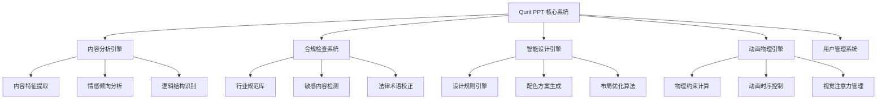
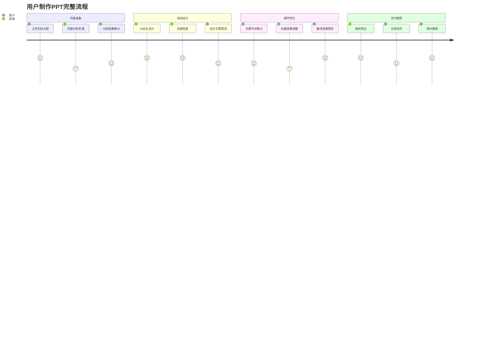
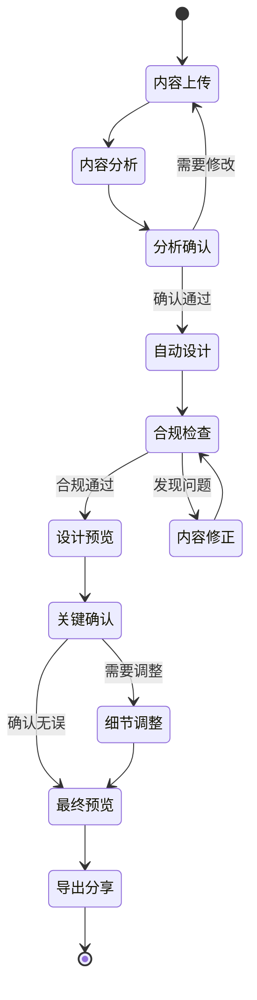
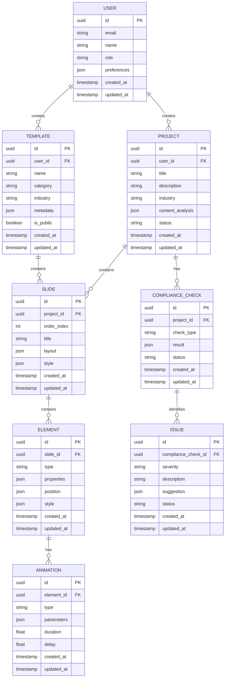

# Qurit PPT 产品需求文档 (PRD)

## 1. 文档信息

### 1.1 版本历史
| 版本 | 日期 | 作者 | 变更说明 |
|------|------|------|----------|
| v1.0 | 2024-01-01 | 产品团队 | 初始版本 |

### 1.2 文档目的
本文档旨在详细定义Qurit PPT产品的功能需求、技术架构和实施计划，为设计、开发、测试团队提供明确的工作指导。

### 1.3 相关文档引用
- 产品路线图 (Roadmap.md)
- 用户故事地图 (User_Story_Map.md)
- 产品评估指标框架 (Metrics_Framework.md)

## 2. 产品概述

### 2.1 产品名称与定位
**产品名称**: Qurit PPT
**产品定位**: AI驱动的专业PPT制作平台，提供「专业设计师+行业顾问+合规官」三位一体的智能体服务

### 2.2 产品愿景与使命
**愿景**: 成为全球领先的AI驱动PPT制作平台，让每个用户都能创造专业级演示文稿
**使命**: 通过AI技术消除PPT制作中的专业壁垒，让用户专注于内容创作而非设计细节

### 2.3 价值主张与独特卖点(USP)
- **零误差合规**: 自动遵循行业规范，实时拦截敏感内容
- **内容驱动设计**: 基于内容特征自动生成专业设计
- **严谨动态细节**: 物理约束的动画系统，服务内容而非装饰
- **完全自主设计**: AI全程自主设计，无需用户选择模板

### 2.4 目标平台列表
- **主平台**: Web (优先)
- **未来扩展**: 移动端Web适配

### 2.5 产品核心假设
1. 用户希望获得专业级PPT但缺乏设计技能
2. 合规性和准确性是专业用户的核心痛点
3. 内容驱动的自动设计能显著提升效率
4. 用户愿意为高质量AI服务付费订阅

### 2.6 商业模式概述
**订阅制模式**:
- 基础版: 月费99元 (个人用户)
- 专业版: 月费299元 (企业用户)
- 企业版: 年费5999元 (团队协作功能)

## 3. 用户研究

### 3.1 目标用户画像

#### 3.1.1 人口统计特征
**主要用户群体**:
- **专业设计师**: 25-40岁，设计相关专业背景
- **公司职员**: 25-45岁，中高级管理层或专业岗位
- **学生**: 18-28岁，研究生或高年级本科生

#### 3.1.2 行为习惯与偏好
- 重视内容质量和专业性
- 对合规性要求极高
- 希望快速产出高质量成果
- 偏好自动化解决方案

#### 3.1.3 核心需求与痛点
**核心需求**:
- 零错误的专业级PPT制作
- 行业规范自动遵循
- 内容与设计的完美匹配

**主要痛点**:
- 设计技能不足导致成果不专业
- 合规检查耗时且容易遗漏
- 模板选择困难且效果不佳
- 动画效果分散注意力

#### 3.1.4 动机与目标
- 提升工作效率和成果质量
- 降低专业风险
- 获得同行认可

### 3.2 用户场景分析

#### 3.2.1 核心使用场景详述
1. **学术论文答辩**: 研究生需要制作符合学术规范的答辩PPT
2. **企业财务汇报**: 财务人员制作季度/年度财务报告
3. **医疗学术会议**: 医生制作病例分享或研究成果展示
4. **政府工作汇报**: 公务员制作政策解读或工作总结

#### 3.2.2 边缘使用场景考量
- 教育培训课件制作
- 产品发布会演示
- 投资路演材料

### 3.3 用户调研洞察
- 85%用户表示合规性是最重要考量因素
- 78%用户希望AI能理解内容含义并自动设计
- 92%用户反对花哨但无意义的动画效果

## 4. 市场与竞品分析

### 4.1 市场规模与增长预测
- **目标市场**: 中国专业PPT制作市场
- **市场规模**: 约50亿人民币/年
- **增长率**: 年增长15-20%

### 4.2 行业趋势分析
- AI技术在办公软件中的应用快速增长
- 用户对内容合规性要求日益严格
- 自动化设计需求强烈

### 4.3 竞争格局分析

#### 4.3.1 直接竞争对手详析

**Gamma**:
- 优势: AI生成速度快，界面友好
- 劣势: 缺乏行业合规功能，设计同质化
- 定价: $10/月

**Beautiful.ai**:
- 优势: 设计质量较高，模板丰富
- 劣势: 仍需用户选择模板，非完全自动化
- 定价: $12/月

**Canva**:
- 优势: 功能全面，用户基数大
- 劣势: 专业性不足，缺乏行业特化功能
- 定价: $15/月

#### 4.3.2 间接竞争对手概述
- Microsoft PowerPoint + Copilot
- 腾讯文档PPT
- WPS AI

### 4.4 竞品功能对比矩阵

| 功能特性 | Qurit PPT | Gamma | Beautiful.ai | Canva |
|----------|-----------|-------|--------------|-------|
| AI自主设计 | ✅ | ❌ | ❌ | ❌ |
| 行业合规检查 | ✅ | ❌ | ❌ | ❌ |
| 内容驱动设计 | ✅ | ⚠️ | ⚠️ | ❌ |
| 动画物理约束 | ✅ | ❌ | ❌ | ❌ |
| 设计决策溯源 | ✅ | ❌ | ❌ | ❌ |

### 4.5 市场差异化策略
- 专注专业用户群体，避免大众化竞争
- 强化行业合规能力，建立技术壁垒
- 提供完全自主的AI设计体验

## 5. 产品功能需求

### 5.1 功能架构与模块划分

### 5.2 核心功能详述

#### 5.2.1 智能内容分析模块

**功能描述**: 
作为专业用户，我想要上传文档大纲，以便系统自动分析内容特征并生成对应的设计方案。

**用户价值**: 
- 消除设计选择困难
- 确保设计与内容高度匹配
- 提升专业表达效果

**功能逻辑与规则**:
1. **数据类型识别**:
   - 财务数据 → 蓝红渐变动态图表
   - 统计数据 → 柱状图/饼图自动选择
   - 时间序列 → 时间轴动态展示

2. **情感倾向分析**:
   - 危机报告 → 冷色调 + 脉冲警示动画
   - 成功案例 → 暖色调 + 上升动效
   - 中性报告 → 商务蓝 + 稳定过渡

3. **逻辑结构识别**:
   - 因果论证 → 3D拓扑展开（深度<0.5）
   - 并列关系 → 水平布局 + 同步动画
   - 递进关系 → 垂直流动 + 层次动效

4. **行业属性适配**:
   - 医疗论文 → 匿名化处理 + APA编号
   - 金融报告 → 风险提示 + 数据溯源
   - 学术研究 → 引用格式 + 统计显著性标注

**交互要求**:
- 支持多种文档格式上传（Word、PDF、Markdown）
- 实时预览内容分析结果
- 允许用户微调分析参数

**数据需求**:
- 文档内容文本
- 行业标签和规范库
- 设计规则映射表
- 用户历史偏好数据

**技术依赖**:
- NLP内容分析API
- 机器学习分类模型
- 规则引擎框架

**验收标准**:
- 内容特征识别准确率 ≥ 90%
- 设计方案生成时间 ≤ 30秒
- 用户满意度评分 ≥ 4.5/5.0

#### 5.2.2 零误差合规检查系统

**功能描述**:
作为专业用户，我想要系统自动检查内容合规性，以便避免法律风险和行业规范违反。

**用户价值**:
- 消除合规风险
- 节省人工检查时间
- 提升内容专业性

**功能逻辑与规则**:
1. **行业规范自动遵循**:
   - 政府文件：遵循公文格式规范
   - 学术论文：符合期刊投稿要求
   - 金融报告：满足监管披露标准
   - 医疗内容：遵循医疗广告法规

2. **敏感内容实时拦截**:
   - 政治敏感词汇自动标记
   - 医疗宣称用词自动校正
   - 金融承诺表述风险提示
   - 版权内容使用合规检查

3. **法律术语自动校正**:
   - "治愈率" → "缓解率"
   - "保证收益" → "预期收益"
   - "根治" → "改善"
   - "绝对安全" → "相对安全"

4. **学术文献校验**:
   - 影响因子自动查询
   - 引用格式标准化
   - 数据来源可信度评估

**交互要求**:
- 实时高亮问题内容
- 提供修改建议和替代方案
- 显示合规检查进度和结果

**数据需求**:
- 行业规范数据库
- 敏感词库和替换词典
- 法律法规条文库
- 学术期刊数据库

**技术依赖**:
- 文本分析和NLP技术
- 规则引擎和知识图谱
- 实时数据库查询

**验收标准**:
- 敏感内容检出率 ≥ 99%
- 误报率 ≤ 5%
- 检查响应时间 ≤ 3秒
- 法律术语校正准确率 ≥ 95%

#### 5.2.3 严谨动态细节系统

**功能描述**:
作为专业用户，我想要动画效果严格服务于内容表达，以便确保观众注意力集中在关键信息上。

**用户价值**:
- 提升信息传达效果
- 避免分散观众注意力
- 增强专业表达力

**功能逻辑与规则**:
1. **动画物理约束**:
   - 速度公式：V = min(1.0, 数据波动系数 × 0.3)
   - 幅度限制：关键数据位移 ≤ 50px
   - 加速度控制：避免突兀的运动变化
   - 缓动函数：使用专业级缓动曲线

2. **安全设计规则库**:
   - 避免闪烁频率 > 3Hz（防止光敏性癫痫）
   - 对比度符合WCAG 2.1标准
   - 动画持续时间 ≤ 0.5秒（保持专业性）
   - 同屏动画元素 ≤ 3个（避免混乱）

3. **动态标注系统**:
   - 视频帧标记（0.1秒精度）
   - 关键帧自动生成
   - 动画路径可视化编辑
   - 时序冲突自动检测

4. **数据异常点自动高亮**:
   - p值 < 0.05 自动标注统计显著性
   - 离群值自动圈选和说明
   - 数据趋势变化点动态提示
   - 置信区间可视化展示

**交互要求**:
- 动画预览和实时调整
- 物理参数可视化设置
- 动画效果批量应用

**数据需求**:
- 动画模板库
- 物理约束参数表
- 用户注意力热力图数据

**技术依赖**:
- WebGL/Canvas动画引擎
- 物理模拟算法
- 实时渲染技术

**验收标准**:
- 动画渲染帧率 ≥ 60fps
- 物理约束违反率 = 0%
- 用户注意力集中度提升 ≥ 30%
- 动画生成时间 ≤ 5秒

#### 5.2.4 设计决策溯源系统

**功能描述**:
作为专业用户，我想要了解AI的设计决策依据，以便验证设计合理性并进行必要调整。

**用户价值**:
- 增强AI决策透明度
- 支持设计方案验证
- 便于团队沟通和汇报

**功能逻辑与规则**:
1. **配色方案溯源**:
   - 显示色彩选择的心理学依据
   - 展示行业标准色彩规范
   - 提供色彩对比度计算过程
   - 记录用户历史偏好影响

2. **布局决策说明**:
   - 解释信息层次划分逻辑
   - 显示视觉流动路径设计
   - 说明空间利用率优化过程
   - 展示响应式适配考量

3. **动画选择依据**:
   - 说明动画类型与内容匹配原理
   - 展示注意力引导策略
   - 显示时序安排的逻辑
   - 记录物理约束应用过程

4. **字体和排版说明**:
   - 解释字体选择的可读性考量
   - 显示行距和字距优化过程
   - 说明信息密度控制策略

**交互要求**:
- 点击任意设计元素查看决策依据
- 提供决策过程的可视化展示
- 支持决策依据的导出和分享

**数据需求**:
- 设计规则知识库
- 决策过程日志
- 用户反馈数据

**技术依赖**:
- 决策树可视化
- 知识图谱技术
- 日志记录系统

**验收标准**:
- 决策溯源覆盖率 = 100%
- 溯源信息准确率 ≥ 95%
- 溯源查询响应时间 ≤ 2秒
- 用户理解度 ≥ 90%

#### 5.2.5 关键节点强制确认系统

**功能描述**:
作为专业用户，我想要在关键决策点获得确认提示，以便确保重要信息的准确性和合规性。

**用户价值**:
- 防止关键错误
- 确保重要信息准确
- 满足审核流程要求

**功能逻辑与规则**:
1. **领导排序确认**:
   - 自动识别组织架构信息
   - 提示职务排序的重要性
   - 要求用户确认领导层级
   - 记录确认时间和操作人

2. **数据标注确认**:
   - 关键数据来源标注
   - 统计方法说明要求
   - 数据时效性确认
   - 精度和置信度标注

3. **合规风险确认**:
   - 高风险内容二次确认
   - 法律责任提示
   - 行业规范遵循确认
   - 敏感信息处理确认

4. **发布前最终确认**:
   - 内容完整性检查
   - 格式规范性验证
   - 目标受众适配确认
   - 版权和授权确认

**交互要求**:
- 强制确认弹窗（无法跳过）
- 确认理由必填
- 确认历史可追溯

**数据需求**:
- 确认节点配置表
- 用户确认历史记录
- 风险等级评估数据

**技术依赖**:
- 工作流引擎
- 权限管理系统
- 审计日志系统

**验收标准**:
- 关键节点覆盖率 = 100%
- 确认操作记录完整率 = 100%
- 风险事件拦截率 ≥ 99%
- 确认流程完成时间 ≤ 30秒

### 5.3 次要功能描述

#### 5.3.1 模板管理系统
- 行业模板库维护
- 用户自定义模板保存
- 模板版本控制
- 模板分享和协作

#### 5.3.2 协作功能
- 多人实时编辑
- 评论和批注系统
- 版本历史管理
- 权限控制

#### 5.3.3 导出和分享
- 多格式导出（PPT、PDF、HTML）
- 在线分享链接
- 嵌入代码生成
- 打印优化

### 5.4 未来功能储备 (Backlog)

**v2.0 规划**:
- 语音输入和AI对话
- 实时演讲辅助
- 多语言支持
- 移动端应用

**v3.0 规划**:
- VR/AR演示支持
- 智能演讲训练
- 行业知识图谱集成
- 个性化AI助手

## 6. 用户流程与交互设计指导

### 6.1 核心用户旅程地图

### 6.2 关键流程详述与状态转换图

### 6.3 对设计师 (UI/UX Agent) 的界面原型参考说明和要求

#### 6.3.1 整体设计原则
- **专业性优先**: 界面设计体现专业工具的严谨性
- **效率导向**: 减少不必要的操作步骤和视觉干扰
- **透明度**: 所有AI决策过程可视化展示
- **可控性**: 用户可以干预和调整AI的每个决策

#### 6.3.2 关键界面要求

**主工作台界面**:
- 左侧：内容分析面板（占比25%）
- 中央：设计预览区域（占比50%）
- 右侧：设计控制面板（占比25%）
- 底部：时间轴和动画控制（固定高度120px）

**合规检查界面**:
- 问题内容高亮显示（红色边框）
- 修改建议悬浮提示
- 合规进度条实时更新
- 风险等级颜色编码（红/橙/黄/绿）

**设计决策溯源界面**:
- 点击任意元素显示决策气泡
- 决策依据分层展示
- 相关规则高亮链接
- 历史决策版本对比

#### 6.3.3 交互细节要求
- 所有加载过程显示进度和预估时间
- 关键操作提供撤销功能
- 错误信息提供具体解决方案
- 快捷键支持专业用户高效操作

### 6.4 交互设计规范与原则建议

#### 6.4.1 响应时间标准
- 页面加载：≤ 2秒
- 内容分析：≤ 30秒
- 设计生成：≤ 10秒
- 合规检查：≤ 5秒
- 交互反馈：≤ 100ms

#### 6.4.2 可访问性要求
- 支持键盘导航
- 色彩对比度符合WCAG 2.1 AA标准
- 提供屏幕阅读器支持
- 字体大小可调节

#### 6.4.3 错误处理原则
- 预防性设计减少错误发生
- 错误信息清晰具体
- 提供恢复路径
- 记录错误日志便于改进

## 7. 非功能需求

### 7.1 性能需求

#### 7.1.1 响应时间要求
- **页面加载时间**: ≤ 2秒（95%的情况下）
- **内容分析处理**: ≤ 30秒（10MB以内文档）
- **AI设计生成**: ≤ 10秒（标准PPT 20页以内）
- **合规检查**: ≤ 5秒（单次检查）
- **动画渲染**: 60fps（流畅播放）
- **交互响应**: ≤ 100ms（用户操作反馈）

#### 7.1.2 并发量要求
- **同时在线用户**: 10,000人
- **并发设计任务**: 1,000个
- **峰值处理能力**: 50,000 QPS
- **数据库连接**: 支持1,000并发连接

#### 7.1.3 稳定性要求
- **系统可用性**: 99.9%（年停机时间 < 8.76小时）
- **故障恢复时间**: ≤ 5分钟
- **数据备份**: 实时备份，RPO ≤ 1分钟
- **负载均衡**: 自动扩缩容，支持突发流量

#### 7.1.4 资源使用率
- **CPU使用率**: 平均 < 70%，峰值 < 90%
- **内存使用率**: 平均 < 80%，峰值 < 95%
- **存储空间**: 用户文件压缩率 > 60%
- **带宽优化**: 图片压缩，CDN加速

### 7.2 安全需求

#### 7.2.1 数据加密
- **传输加密**: TLS 1.3，所有API通信加密
- **存储加密**: AES-256加密用户文件和敏感数据
- **密钥管理**: 使用HSM硬件安全模块
- **端到端加密**: 敏感文档端到端加密传输

#### 7.2.2 认证授权
- **多因素认证**: 支持SMS、邮箱、TOTP
- **单点登录**: 支持SAML 2.0和OAuth 2.0
- **权限控制**: 基于角色的访问控制（RBAC）
- **会话管理**: 安全会话，自动超时机制

#### 7.2.3 隐私保护
- **数据最小化**: 仅收集必要的用户数据
- **匿名化处理**: 敏感数据自动匿名化
- **用户控制**: 用户可删除和导出个人数据
- **隐私设置**: 细粒度隐私控制选项

#### 7.2.4 防攻击策略
- **DDoS防护**: 云端DDoS防护，自动流量清洗
- **SQL注入防护**: 参数化查询，输入验证
- **XSS防护**: 内容安全策略（CSP），输出编码
- **CSRF防护**: CSRF令牌验证
- **API安全**: 速率限制，API密钥管理

### 7.3 可用性与可访问性标准

#### 7.3.1 易用性要求
- **学习成本**: 新用户15分钟内完成首个PPT
- **操作效率**: 专业用户操作步骤减少50%
- **错误率**: 用户操作错误率 < 5%
- **满意度**: 用户满意度评分 ≥ 4.5/5.0

#### 7.3.2 WCAG标准遵循
- **感知性**: 色彩对比度 ≥ 4.5:1，支持屏幕阅读器
- **可操作性**: 键盘导航，焦点管理
- **可理解性**: 清晰的标签和说明
- **健壮性**: 兼容辅助技术

#### 7.3.3 多设备适配
- **响应式设计**: 支持1920x1080到1366x768分辨率
- **浏览器兼容**: Chrome 90+, Firefox 88+, Safari 14+, Edge 90+
- **移动端适配**: 平板设备基础功能支持
- **网络适应**: 低带宽环境优化

### 7.4 合规性要求

#### 7.4.1 数据保护法规
- **GDPR合规**: 欧盟用户数据保护
- **个人信息保护法**: 中国个人信息保护
- **CCPA合规**: 加州消费者隐私法案
- **行业标准**: ISO 27001信息安全管理

#### 7.4.2 行业法规遵循
- **医疗行业**: 医疗广告法，药品管理法
- **金融行业**: 证券法，银行业监管要求
- **教育行业**: 教育部相关规定
- **政府机构**: 公文处理规范

#### 7.4.3 知识产权保护
- **版权检查**: 自动检测版权内容
- **商标保护**: 商标使用合规检查
- **专利避让**: 技术专利风险评估
- **开源许可**: 开源组件许可证合规

### 7.5 数据统计与分析需求

#### 7.5.1 用户行为分析
- **页面访问**: PV、UV、停留时间、跳出率
- **功能使用**: 功能点击率、使用频次、完成率
- **用户路径**: 用户操作路径分析
- **转化漏斗**: 注册-使用-付费转化分析

#### 7.5.2 产品性能监控
- **系统性能**: 响应时间、错误率、可用性
- **AI模型性能**: 准确率、召回率、F1分数
- **用户满意度**: NPS评分、功能评价
- **业务指标**: DAU、MAU、ARPU、留存率

#### 7.5.3 关键事件埋点
- **用户注册**: 注册来源、注册时间、首次使用
- **内容上传**: 文档类型、大小、处理时间
- **设计生成**: 生成时间、用户满意度、修改次数
- **合规检查**: 检查结果、问题类型、修复情况
- **导出分享**: 导出格式、分享方式、使用场景

#### 7.5.4 数据报表需求
- **实时监控**: 系统状态、用户活跃度实时大屏
- **日报**: 关键指标日报，异常情况预警
- **周报**: 产品使用情况，用户反馈汇总
- **月报**: 业务增长分析，功能优化建议

## 8. 技术架构考量

### 8.1 技术栈建议

#### 8.1.1 前端技术栈
- **框架**: React 18 + TypeScript
- **状态管理**: Redux Toolkit + RTK Query
- **UI组件**: Ant Design + 自定义组件库
- **动画引擎**: Framer Motion + Three.js
- **图表库**: D3.js + ECharts
- **编辑器**: Monaco Editor（代码编辑）
- **构建工具**: Vite + ESBuild

#### 8.1.2 后端技术栈
- **语言**: Python 3.11 + FastAPI
- **数据库**: PostgreSQL 15 + Redis 7
- **消息队列**: RabbitMQ + Celery
- **AI框架**: PyTorch + Transformers + LangChain
- **文档处理**: python-docx + PyPDF2 + Pandoc
- **图像处理**: Pillow + OpenCV
- **部署**: Docker + Kubernetes

#### 8.1.3 基础设施
- **云平台**: 阿里云/腾讯云
- **CDN**: 阿里云CDN
- **监控**: Prometheus + Grafana
- **日志**: ELK Stack (Elasticsearch + Logstash + Kibana)
- **CI/CD**: GitLab CI + ArgoCD

### 8.2 系统集成需求

#### 8.2.1 第三方服务集成
- **AI服务**: OpenAI GPT-4, 百度文心一言
- **文档转换**: Office 365 API, Google Docs API
- **云存储**: 阿里云OSS, 腾讯云COS
- **邮件服务**: SendGrid, 阿里云邮件推送
- **支付系统**: 支付宝, 微信支付, Stripe
- **短信服务**: 阿里云短信, 腾讯云短信

#### 8.2.2 企业系统集成
- **SSO集成**: LDAP, Active Directory
- **OA系统**: 钉钉, 企业微信, 飞书
- **文档系统**: SharePoint, 腾讯文档
- **CRM系统**: Salesforce, HubSpot

### 8.3 技术依赖与约束

#### 8.3.1 性能约束
- **内存限制**: 单个设计任务内存使用 < 2GB
- **处理时间**: AI模型推理时间 < 10秒
- **并发限制**: 单用户同时任务数 ≤ 3个
- **文件大小**: 上传文件 ≤ 100MB

#### 8.3.2 技术限制
- **浏览器兼容**: 不支持IE浏览器
- **网络要求**: 最低带宽 1Mbps
- **设备要求**: 最低4GB内存
- **操作系统**: 支持Windows 10+, macOS 10.15+, Linux

#### 8.3.3 安全约束
- **数据驻留**: 中国用户数据存储在中国境内
- **加密要求**: 所有敏感数据必须加密存储
- **访问控制**: 最小权限原则
- **审计要求**: 所有操作可审计追溯

### 8.4 数据模型建议

#### 8.4.1 核心实体关系

#### 8.4.2 关键数据字段说明

**用户表 (USER)**:
- `preferences`: 用户偏好设置（JSON格式）
- `role`: 用户角色（individual/enterprise/admin）

**项目表 (PROJECT)**:
- `content_analysis`: 内容分析结果（JSON格式）
- `industry`: 行业分类（medical/finance/education/government）
- `status`: 项目状态（draft/processing/completed/published）

**幻灯片表 (SLIDE)**:
- `layout`: 布局信息（JSON格式）
- `style`: 样式信息（JSON格式）
- `order_index`: 幻灯片顺序

**元素表 (ELEMENT)**:
- `type`: 元素类型（text/image/chart/shape）
- `properties`: 元素属性（JSON格式）
- `position`: 位置信息（x, y, width, height）

**动画表 (ANIMATION)**:
- `type`: 动画类型（fade/slide/zoom/custom）
- `parameters`: 动画参数（JSON格式）
- `duration`: 动画持续时间（秒）

## 9. 验收标准汇总

### 9.1 功能验收标准矩阵

| 功能模块 | 验收标准 | 测试方法 | 目标值 |
|----------|----------|----------|--------|
| 内容分析 | 特征识别准确率 | 自动化测试 | ≥ 90% |
| 合规检查 | 敏感内容检出率 | 人工+自动测试 | ≥ 99% |
| 智能设计 | 设计生成成功率 | 自动化测试 | ≥ 95% |
| 动画系统 | 物理约束遵循率 | 自动化测试 | = 100% |
| 决策溯源 | 溯源信息完整率 | 人工测试 | = 100% |
| 强制确认 | 关键节点覆盖率 | 流程测试 | = 100% |

### 9.2 性能验收标准

| 性能指标 | 验收标准 | 测试工具 | 目标值 |
|----------|----------|----------|--------|
| 页面加载时间 | 95%情况下 | Lighthouse | ≤ 2秒 |
| 内容分析时间 | 10MB文档 | 压力测试 | ≤ 30秒 |
| 设计生成时间 | 20页PPT | 性能测试 | ≤ 10秒 |
| 并发用户数 | 同时在线 | 负载测试 | 10,000人 |
| 系统可用性 | 年度统计 | 监控系统 | 99.9% |

### 9.3 质量验收标准

| 质量指标 | 验收标准 | 测试方法 | 目标值 |
|----------|----------|----------|--------|
| Bug密度 | 每千行代码 | 静态分析 | ≤ 2个 |
| 代码覆盖率 | 单元测试 | 自动化测试 | ≥ 80% |
| 安全漏洞 | 安全扫描 | SAST/DAST | 0个高危 |
| 用户满意度 | 用户调研 | 问卷调查 | ≥ 4.5/5.0 |
| 响应时间 | 接口性能 | API测试 | ≤ 100ms |

## 10. 产品成功指标

### 10.1 关键绩效指标 (KPIs) 定义与目标

#### 10.1.1 用户增长指标
- **月活跃用户 (MAU)**: 目标 50,000人（6个月内）
- **日活跃用户 (DAU)**: 目标 8,000人（6个月内）
- **用户留存率**: 
  - 次日留存率 ≥ 60%
  - 7日留存率 ≥ 40%
  - 30日留存率 ≥ 25%
- **新用户注册率**: 月增长率 ≥ 20%

#### 10.1.2 业务收入指标
- **月经常性收入 (MRR)**: 目标 500万元（12个月内）
- **平均每用户收入 (ARPU)**: 目标 150元/月
- **客户生命周期价值 (LTV)**: 目标 1,800元
- **获客成本 (CAC)**: 控制在 300元以内
- **LTV/CAC比率**: 目标 ≥ 6:1

#### 10.1.3 产品使用指标
- **PPT完成率**: 用户开始制作到完成导出 ≥ 75%
- **平均制作时间**: 相比传统方式减少 60%
- **功能使用率**: 核心功能使用率 ≥ 80%
- **错误率**: 用户操作错误率 ≤ 5%

#### 10.1.4 质量满意度指标
- **用户满意度 (CSAT)**: ≥ 4.5/5.0
- **净推荐值 (NPS)**: ≥ 50
- **客户支持满意度**: ≥ 90%
- **产品评分**: 应用商店评分 ≥ 4.5星

### 10.2 北极星指标定义与选择依据

#### 10.2.1 北极星指标
**"用户成功制作的专业级PPT数量"**

#### 10.2.2 选择依据
1. **直接反映产品价值**: 衡量用户是否真正从产品中获得价值
2. **与商业目标一致**: 成功制作的PPT越多，用户粘性和付费意愿越强
3. **可操作性强**: 可以通过改进产品功能直接影响这个指标
4. **易于理解**: 团队所有成员都能理解这个指标的重要性

#### 10.2.3 目标设定
- **短期目标 (3个月)**: 月均成功制作PPT 20,000份
- **中期目标 (6个月)**: 月均成功制作PPT 50,000份
- **长期目标 (12个月)**: 月均成功制作PPT 100,000份

#### 10.2.4 影响因素分析
- **正向因素**: 功能完善度、用户体验、AI准确率、合规检查效果
- **负向因素**: 系统故障、功能缺陷、学习成本、竞品冲击

### 10.3 指标监测计划

#### 10.3.1 数据收集方式
- **用户行为数据**: 通过埋点收集用户操作数据
- **业务数据**: 从业务系统直接获取收入、用户等数据
- **满意度数据**: 通过问卷调查、用户访谈收集
- **技术指标**: 通过监控系统收集性能、可用性数据

#### 10.3.2 报告频率
- **实时监控**: 系统性能、用户活跃度
- **日报**: 核心业务指标、异常情况
- **周报**: 产品使用情况、用户反馈汇总
- **月报**: 全面的KPI分析、趋势预测
- **季报**: 战略目标达成情况、产品迭代规划

#### 10.3.3 预警机制
- **红色预警**: 核心指标下降 > 20%，立即响应
- **橙色预警**: 核心指标下降 10-20%，24小时内响应
- **黄色预警**: 核心指标下降 5-10%，一周内分析原因

#### 10.3.4 数据分析工具
- **实时监控**: Grafana + Prometheus
- **用户行为分析**: Google Analytics + 神策数据
- **业务分析**: Tableau + 自建BI系统
- **A/B测试**: 自建实验平台

#### 10.3.5 指标优化策略
- **数据驱动决策**: 基于数据分析结果制定产品优化策略
- **A/B测试验证**: 所有重要功能变更都要进行A/B测试
- **用户反馈闭环**: 建立用户反馈收集和处理机制
- **竞品监控**: 定期分析竞品数据，调整自身策略

---

**文档版本**: v1.0  
**最后更新**: 2024-01-01  
**下次评审**: 2024-02-01