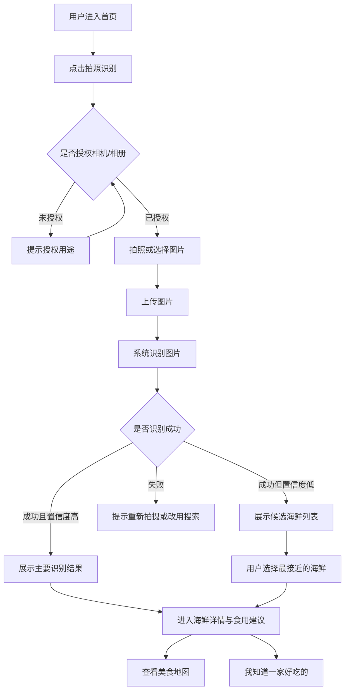
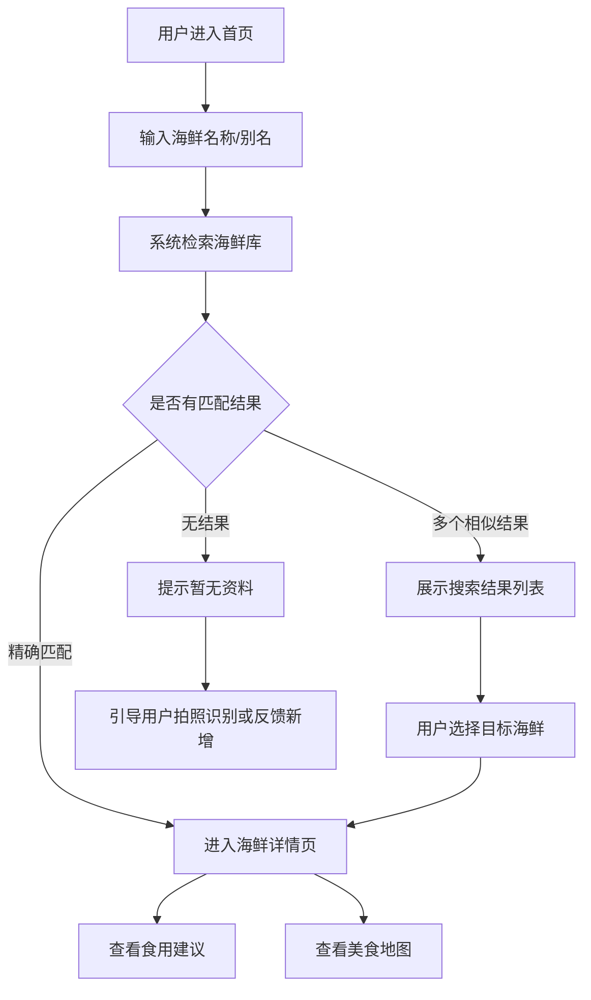
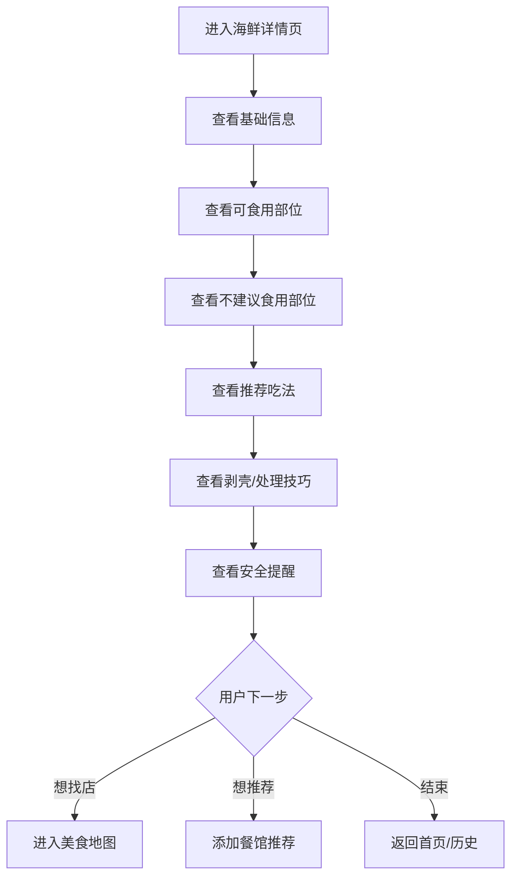
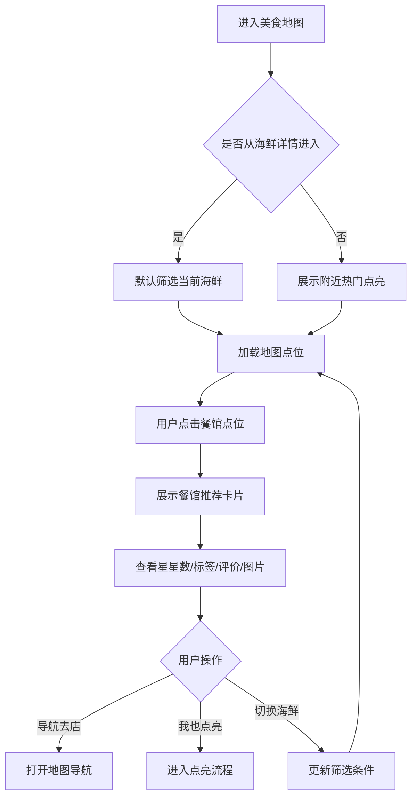
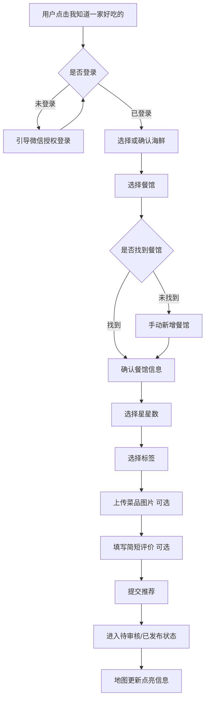

# 识鲜地图 PRD v0.1

## 1. 产品定位

识鲜地图是一款面向普通消费者的熟海鲜识别、食用建议与本地美食地图小程序。

用户可以通过拍照或文字搜索了解某种熟海鲜是什么、怎么吃、有哪些注意事项，也可以把自己觉得好吃的餐馆标记到地图上，和其他用户共同沉淀“哪里吃这种海鲜好吃”。

## 2. MVP 目标

v0.1 先验证三个核心闭环：

1. 用户能通过拍照识别熟海鲜。
2. 用户能通过搜索查看熟海鲜信息和食用建议。
3. 用户能把“某家餐馆的某种海鲜好吃”点亮到地图上。

## 3. MVP 范围

### 3.1 包含

- 熟海鲜拍照识别
- 熟海鲜文字搜索
- 海鲜详情页
- 食用建议
- 基础安全提醒
- 美食地图
- 用户点亮餐馆星星
- 查看某种海鲜对应的推荐餐馆

### 3.2 暂不包含

- 生鲜识别
- 新鲜度判断
- 是否有毒判断
- 商家入驻
- 团购交易
- 私信关注
- 完整社区动态流
- 复杂推荐算法

## 4. 用户角色

### 4.1 普通用户

- 拍照识别海鲜
- 搜索海鲜信息
- 查看食用建议
- 查看附近推荐餐馆
- 点亮自己喜欢的餐馆

### 4.2 内容管理员

- 维护海鲜基础资料
- 审核用户上传图片和评论
- 处理错误餐馆信息
- 管理高风险提示内容

## 5. 核心用户流程

### 5.1 拍照识别熟海鲜流程



#### 关键规则

- 只识别熟制海鲜，无法确认熟制状态时需要提示“结果仅供参考”。
- 置信度高于等于 80% 时展示主结果。
- 置信度 50%-79% 时展示候选结果，不直接下定论。
- 置信度低于 50% 或识别失败时，引导用户重新拍摄或使用搜索。
- 图片应尽量包含完整海鲜主体，避免强遮挡、过暗、严重模糊。

### 5.2 文字搜索海鲜流程



#### 关键规则

- 支持海鲜标准名、常见别名、地方叫法搜索。
- 搜索结果优先展示标准名，其次展示别名匹配项。
- 无结果时保留用户搜索词，方便后续作为内容库补充线索。

### 5.3 查看海鲜详情流程



#### 详情页信息结构

- 海鲜名称
- 别名
- 图片
- 简介
- 常见做法
- 推荐蘸料/搭配
- 可食用部位
- 不建议食用部位
- 剥壳/处理技巧
- 安全提醒
- 附近推荐餐馆

### 5.4 美食地图查看流程



#### 关键规则

- 用户从某个海鲜详情进入地图时，默认只看该海鲜相关餐馆。
- 用户从首页进入地图时，默认展示附近热门点亮餐馆。
- 地图点位聚合展示，避免点位过密。
- 餐馆卡片优先展示和当前海鲜有关的信息，不做泛餐馆点评。

### 5.5 点亮餐馆星星流程



#### 关键规则

- 用户必须登录后才能点亮餐馆。
- 首版星星数使用 1-5 星。
- 标签优先于长评论，降低用户输入成本。
- 图片和评论可以选填，但星星、海鲜、餐馆、位置必须填写。
- 用户提交后进入审核机制；MVP 可先使用“先发布、后举报/抽审”的轻审核模式。

## 6. 功能需求清单

### 6.1 首页

| 编号 | 需求 | 优先级 | 验收标准 |
| --- | --- | --- | --- |
| HOME-001 | 首页提供拍照识别入口 | P0 | 用户点击后可进入拍照/相册选择流程 |
| HOME-002 | 首页提供搜索框 | P0 | 用户输入关键词后可进入搜索结果页 |
| HOME-003 | 首页展示热门熟海鲜 | P1 | 至少展示 6 个热门海鲜入口 |
| HOME-004 | 首页展示附近热门点亮 | P1 | 授权定位后展示附近餐馆推荐 |
| HOME-005 | 首页展示历史识别记录 | P2 | 用户可快速回看最近识别结果 |

### 6.2 拍照识别

| 编号 | 需求 | 优先级 | 验收标准 |
| --- | --- | --- | --- |
| REC-001 | 用户可拍照上传海鲜图片 | P0 | 支持调用相机拍照并上传 |
| REC-002 | 用户可从相册选择图片 | P0 | 支持选择本地图片并上传 |
| REC-003 | 系统返回识别结果 | P0 | 返回海鲜名称、置信度、候选结果 |
| REC-004 | 低置信度时展示候选项 | P0 | 置信度低于 80% 时不直接给唯一结论 |
| REC-005 | 识别失败时提供兜底路径 | P0 | 展示重新拍摄和文字搜索入口 |
| REC-006 | 保存识别记录 | P2 | 成功识别后进入用户历史记录 |

### 6.3 搜索

| 编号 | 需求 | 优先级 | 验收标准 |
| --- | --- | --- | --- |
| SEARCH-001 | 支持标准名搜索 | P0 | 搜索“皮皮虾”可命中详情页 |
| SEARCH-002 | 支持别名搜索 | P0 | 搜索“虾爬子”可命中皮皮虾 |
| SEARCH-003 | 支持模糊匹配 | P1 | 输入部分关键词可展示相关结果 |
| SEARCH-004 | 无结果时可反馈新增 | P2 | 用户可提交未收录关键词 |

### 6.4 海鲜详情

| 编号 | 需求 | 优先级 | 验收标准 |
| --- | --- | --- | --- |
| DETAIL-001 | 展示海鲜基础信息 | P0 | 包含名称、别名、图片、简介 |
| DETAIL-002 | 展示食用建议 | P0 | 包含常见吃法、推荐蘸料/搭配 |
| DETAIL-003 | 展示可食用部位 | P0 | 明确列出可食用部位 |
| DETAIL-004 | 展示不建议食用部位 | P0 | 明确列出外壳、硬刺、内脏等提醒 |
| DETAIL-005 | 展示剥壳/处理技巧 | P1 | 给出简短实用的处理步骤 |
| DETAIL-006 | 展示安全提醒 | P0 | 至少包含过敏、特殊人群、异味变质提醒 |
| DETAIL-007 | 展示推荐餐馆入口 | P0 | 可进入该海鲜的美食地图 |
| DETAIL-008 | 展示添加推荐入口 | P0 | 可进入点亮餐馆流程 |

### 6.5 美食地图

| 编号 | 需求 | 优先级 | 验收标准 |
| --- | --- | --- | --- |
| MAP-001 | 展示地图点位 | P0 | 用户可看到附近餐馆点位 |
| MAP-002 | 支持按海鲜筛选 | P0 | 从详情页进入时默认筛选当前海鲜 |
| MAP-003 | 展示餐馆推荐卡片 | P0 | 点击点位展示餐馆、星星数、标签、评价 |
| MAP-004 | 支持切换筛选海鲜 | P1 | 用户可在地图页切换海鲜品类 |
| MAP-005 | 支持定位授权 | P0 | 未授权时提示授权用途，并提供手动城市兜底 |
| MAP-006 | 支持地图导航 | P2 | 点击导航可跳转系统地图或小程序地图能力 |

### 6.6 点亮餐馆

| 编号 | 需求 | 优先级 | 验收标准 |
| --- | --- | --- | --- |
| STAR-001 | 用户登录后可点亮餐馆 | P0 | 未登录用户先进入登录授权 |
| STAR-002 | 用户可选择海鲜 | P0 | 支持从详情页带入，也支持手动选择 |
| STAR-003 | 用户可选择餐馆位置 | P0 | 支持地图选择或搜索餐馆 |
| STAR-004 | 用户可手动新增餐馆 | P1 | 搜索不到餐馆时可补充名称和位置 |
| STAR-005 | 用户可选择 1-5 星 | P0 | 星星数为必填项 |
| STAR-006 | 用户可选择推荐标签 | P1 | 至少支持 6 个预设标签 |
| STAR-007 | 用户可上传菜品图片 | P2 | 图片为选填，提交后进入审核 |
| STAR-008 | 用户可填写简短评价 | P2 | 评价为选填，限制最大字数 |
| STAR-009 | 提交后更新地图展示 | P0 | 审核通过或轻审核发布后地图可见 |

### 6.7 内容管理与审核

| 编号 | 需求 | 优先级 | 验收标准 |
| --- | --- | --- | --- |
| CMS-001 | 管理员可维护海鲜资料 | P0 | 可新增、编辑、下架海鲜条目 |
| CMS-002 | 管理员可维护安全提醒 | P0 | 高风险提示支持独立编辑 |
| CMS-003 | 管理员可审核用户图片 | P1 | 可通过、拒绝、隐藏图片 |
| CMS-004 | 管理员可审核用户评论 | P1 | 可通过、拒绝、隐藏评论 |
| CMS-005 | 管理员可处理餐馆纠错 | P2 | 可合并重复餐馆和修正位置 |

## 7. 数据结构草案

### 7.1 海鲜

```json
{
  "id": "seafood_001",
  "name": "皮皮虾",
  "aliases": ["虾蛄", "濑尿虾", "虾爬子"],
  "supported_states": ["cooked"],
  "description": "常见甲壳类海鲜，肉质紧实，适合椒盐、清蒸、白灼。",
  "edible_parts": ["虾肉", "虾籽"],
  "inedible_parts": ["外壳", "硬刺"],
  "eating_tips": ["从腹部或两侧剪开更容易取肉"],
  "recommended_methods": ["椒盐", "清蒸", "白灼"],
  "pairings": ["姜醋", "蒜蓉", "辣椒盐"],
  "warnings": ["甲壳类过敏者慎食", "有明显异味或肉质发黏时不建议食用"],
  "status": "published"
}
```

### 7.2 识别结果

```json
{
  "recognition_id": "recog_001",
  "image_url": "https://example.com/image.jpg",
  "top_result": {
    "seafood_id": "seafood_001",
    "name": "皮皮虾",
    "confidence": 0.86
  },
  "candidates": [
    {
      "seafood_id": "seafood_001",
      "name": "皮皮虾",
      "confidence": 0.86
    }
  ],
  "processing_state": "cooked",
  "created_by": "user_001",
  "created_at": "2026-06-01T13:55:00+08:00"
}
```

### 7.3 餐馆推荐

```json
{
  "id": "recommendation_001",
  "seafood_id": "seafood_001",
  "restaurant_id": "restaurant_001",
  "stars": 5,
  "tags": ["肉多", "入味", "适合聚餐"],
  "comment": "椒盐皮皮虾很香，壳薄肉多。",
  "images": [],
  "created_by": "user_001",
  "status": "published",
  "created_at": "2026-06-01T13:55:00+08:00"
}
```

### 7.4 餐馆

```json
{
  "id": "restaurant_001",
  "name": "阿强海鲜排档",
  "address": "示例市示例区示例路 88 号",
  "location": {
    "latitude": 30.123,
    "longitude": 120.456
  },
  "source": "user_created",
  "status": "published"
}
```

## 8. 安全与合规边界

- 识别结果仅供参考，不作为食品安全或医疗判断依据。
- 当前版本只面向熟海鲜，不判断生鲜是否新鲜、是否可生食、是否有毒。
- 低置信度时展示候选项和兜底路径，不输出绝对结论。
- 对河豚、织纹螺等高风险品类，即使出现候选结果，也应优先展示强安全提醒。
- 过敏、孕妇、儿童、痛风、高尿酸等人群只做通用风险提醒，不提供诊疗建议。
- 用户定位必须经过授权，不能默认暴露用户实时位置。
- 用户上传图片、评论、餐馆信息需要具备审核、举报和下架能力。

## 9. 版本规划

| 版本 | 目标 |
| --- | --- |
| v0.1 | 完成 PRD、核心流程、需求清单 |
| v0.2 | 完成低保真原型和页面字段设计 |
| v0.3 | 完成本地 Mock 数据版本 |
| v0.4 | 接入图片上传和 AI 识别能力 |
| v0.5 | 接入地图与用户点亮功能 |
| v1.0 | 形成可体验 MVP |

## 10. 文档与代码规范约束

项目后续文档、接口、数据库、后端代码和前端代码统一参考阿里规范体系执行。

当前技术路线确定为：

- 前端：`uni-app + Vue 3 + TypeScript`
- 后端：`Java 21 + Spring Boot`
- 数据库：`MySQL 8`
- 图片存储：`阿里云 OSS`
- AI 识别：`阿里云百炼 Qwen 视觉理解`
- 地图能力：`微信小程序地图能力 + 腾讯位置服务`

### 10.1 通用要求

- 文档结构清晰，需求、流程、字段、验收标准分开描述。
- 命名准确表达业务含义，避免无意义缩写。
- 接口字段使用稳定、可扩展的数据结构，避免前后端隐式约定。
- 需求变更需要更新 PRD、接口说明和数据结构文档。
- 涉及安全、审核、用户隐私、定位权限的功能必须在文档中明确边界。

### 10.2 后端规范方向

- 参考《阿里巴巴 Java 开发手册》的命名、分层、异常、日志、集合、并发、数据库和工程规约。
- 领域对象命名保持一致，例如 `Seafood`、`Restaurant`、`Recommendation`、`RecognitionRecord`。
- 禁止使用魔法值，状态、类型、审核结果等字段使用枚举或常量。
- 异常处理区分用户可感知错误和系统内部错误。
- 日志避免输出用户隐私、定位明细、图片原始敏感信息。

### 10.3 数据库规范方向

- 表名、字段名使用小写字母和下划线。
- 表必须包含主键、创建时间、更新时间，用户生成内容建议包含状态字段。
- 金额、评分、经纬度等字段使用明确精度。
- 高频查询字段需要提前考虑索引，例如 `seafood_id`、`restaurant_id`、`city_code`、`status`。
- 删除优先使用逻辑删除，避免误删用户内容和审核证据。

### 10.4 前端规范方向

- 页面、组件、接口请求、状态管理职责分离。
- 组件命名表达业务语义，避免大而全页面组件。
- 用户授权、识别失败、低置信度、无搜索结果、地图加载失败都需要有明确状态。
- 不把后端返回文案硬编码到多个页面，通用提示集中管理。

### 10.5 Git 规范方向

- `main` 分支保持稳定。
- 功能开发使用 `feature/*` 分支。
- 文档修改使用 `docs/*` 分支。
- 修复问题使用 `fix/*` 分支。
- Commit 信息使用清晰动词和范围，例如 `docs: add prd v0.1 user flows`。
