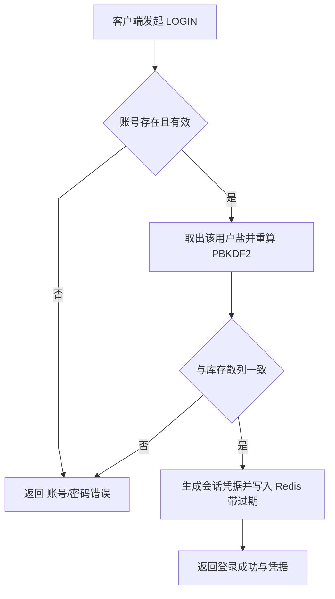

# module_account_v1 漏判与误判

## AH01  标准：['A2']  预测：['A2', 'A3']
> ### F1 注册
- **业务规则**：用户名 8–32 字符且仅由英文字母与数字组成（a-z A-Z 0-9），全局唯一；口令 8–64 字符，字符集仅限 ASCII 可打印字符（英文字母/数字及常见符号），至少含 1 个字母与 1 个数字；禁止非 ASCII 字符、空格、制表符/换行/回车等空白与控制字符（**服务端强制**）；口令+随机盐经 PBKDF2-HMAC-SHA256 生成散列；**明文口令绝不落盘/不进日志/不回显**；口令仅经 TLS 一次性传输，服务端校验长度/强度；**两次确认在客户端完成**，服务端仅接收一个口令字段；注册成功即签发会话凭据（自动登录）。
- **验收标准**：① 新用户名注册成功并可登录；② 重复用户名被拒绝且返回明确错误码；③ 用户名长度（<8 或 >32）或含非法字符（非英文字母/数字），或口令长度/强度（<8、>64、缺字母或数字、含非 ASCII、含空格/制表/换行等空白与控制字符）不符均被拒并返回对应错误码；④ 数据库中仅存散列与盐，检索不到明文；⑤ 日志无明文口令。
- 误判 A3：「注册成功即签发会话凭据（自动登录）」段落描述了注册后自动登录并保持登录状态，但未写会话凭据的有效期或失效条件。

## AH04  标准：['A1']  预测：['A1', 'A3']
> ### A. 登录

- 误判 A3：「「生成会话凭据并写入 Redis 带过期」只说明凭据带过期，未写具体有效期时长或失效条件」段落描述了登录态保持（会话凭据写入 Redis），但未写明登录状态多久后或什么条件下失效。

## AH06  标准：['A1']  预测：['A1', 'A3']
> ### 8.1 认证与账号

目标：提供安全、完整、可用于中后台的账号闭环。

功能：

- 邮箱 + 密码登录。
- JWT access token。
- 退出登录。
- 获取当前用户。
- 更新个人资料。
- 修改密码。
- 忘记密码和重置密码。
- 默认超级管理员初始化。
- 禁用用户不可登录。
- 登录日志记录成功和失败。

验收标准：

- 默认管理员可以登录。
- 禁用用户无法登录和访问接口。
- 修改密码后旧密码失效。
- 重置密码 token 有过期时间。
- 登录失败不暴露账号是否存在等敏感细节。
- 误判 A3：「段落写了「JWT access token」和「退出登录」，但没有写 token 的有效期、超时时长或过期后需重新登录」描述了登录状态保持方式（JWT access token），却未规定登录状态失效时间或条件。

## AH08  标准：['A4']  预测：无问题
> ### 8.3 角色与权限

目标：形成可复用 RBAC 权限体系，替代单一 `is_superuser` 判断。

功能：

- 角色列表、新增、编辑、删除。
- 角色启用/禁用。
- 系统内置角色保护。
- 给角色分配菜单、按钮和接口权限码。
- 用户绑定一个或多个角色。
- 超级管理员默认拥有全部权限。
- 普通用户按角色权限访问菜单和接口。

验收标准：

- 普通用户看不到无权限菜单。
- 普通用户直接请求无权限接口返回 403。
- 修改角色权限后，用户重新登录或刷新权限后生效。
- 系统角色不能被误删或破坏。
- 漏判：['A4']

## AH12  标准：['A1']  预测：['A1', 'A3']
> ### 5.2 登录页

目标：

- 让已有账号用户登录系统。

核心组件：

- 邮箱/用户名输入框。
- 密码输入框。
- 登录按钮。
- 登录失败提示。

交互规则：

- 不展示公开注册入口。
- 登录成功后进入今日简报。
- 被禁用用户登录失败，并展示明确提示。
- 误判 A3：「交互规则只写了「登录成功后进入今日简报」，没有写登录状态的有效期、超时时长或失效后需重新登录的条件」段落描述了登录成功后的状态保持，但未规定登录状态的失效时间或条件。

## AH24  标准：无问题  预测：['A4']
> ### 7.11 管理后台

管理后台用于自托管实例的用户和权限治理。

用户管理：

- 查看用户列表。
- 搜索用户。
- 新增用户。
- 禁用/启用用户。
- 重置用户密码。
- 修改用户角色。
- 查看用户绑定邮箱。
- 查看用户最近登录时间。

用户组管理：

- 创建用户组。
- 编辑用户组名称和描述。
- 添加或移除成员。
- 为用户组配置默认权限。
- 将用户组授权到空间或文档。

系统管理：

- 开放注册开关。
- 邮件服务配置。
- 验证码策略配置。
- 文件上传限制。
- 系统审计日志。
- 数据备份与恢复入口。

验收标准：

- 管理员可登录后台管理用户和用户组。
- 管理员可禁用用户，被禁用用户无法登录。
- 管理员可配置邮件服务并发送测试邮件。
- 误判 A4：「用户管理部分列出了新增用户、禁用/启用用户、重置用户密码、修改用户角色等管理操作，但段内没有要求记录这些操作；系统管理里只有「系统审计日志」这一功能项，并未说明要记录账号与权限操作」段落描述了管理员对他人账号和权限的操作，却没有要求记录操作日志或审计日志。

## AH26  标准：['A1', 'A3', 'A4']  预测：['A1', 'A2', 'A3', 'A4']
> ### M1 · 用户与账户体系

**模块背景**：当前所有会话全局共享、无任何用户概念（`chatStore` 注释明确"单用户 demo，鉴权以后再加 user_id"）。要对外开放，必须建立账户、权限与数据隔离。

| 编号 | 需求 | 优先级 | 描述与功能点 | 验收标准 |
|---|---|---|---|---|
| FR-M1-01 | 用户注册 | P0 | 提供注册页面；支持邮箱/用户名 + 密码注册；密码加盐哈希存储；基本校验（唯一性、强度） | 新用户可注册成功并落库；重复账号被拒；密码非明文存储 |
| FR-M1-02 | 用户登录 | P0 | 提供登录页面；签发会话凭证（JWT/Session）；登录态在前端持久化与刷新续期 | 正确凭证可登录并保持登录态；错误凭证被拒；登出可清除登录态 |
| FR-M1-03 | 匿名使用 | P0 | 保留当前"无需登录即可使用"的体验；**匿名会话的数据保存在本地 better-sqlite3**（不进服务端 PostgreSQL），与注册用户的云端数据物理隔离；可引导登录后将本地匿名数据导入到账户 | 未登录用户仍可完整体验讨论 + 纪要；匿名数据落本地 better-sqlite3、与注册用户数据隔离；登录后可选导入 |
| FR-M1-04 | 用户权限等级 | P0 | 定义角色与权限分级（如 匿名 / 普通用户 / 管理员）；不同等级对应不同工具调用、模型配置、用量上限 | 越权操作被后端拒绝并返回明确错误；权限可由管理员调整 |
| FR-M1-05 | 用户级会话持久化隔离 | P0 | `sessions` / `messages` 增加 `user_id`；所有会话读写按当前用户过滤；提供数据迁移脚本兼容旧的无 user 数据 | 用户只能看到/操作自己的会话；跨用户访问被拒；旧数据平滑迁移 |
| FR-M1-06 | 用户级记忆管理 | P1 | 为每个用户维护跨会话的长期记忆（偏好、历史结论摘要等），并在新会话中可选注入；提供记忆的查看/编辑/清除 | 记忆按 user 隔离；可被检索注入；用户可管理自己的记忆 |

**关键交互流程（注册→登录→隔离）**
1. 访客打开应用 → 可直接匿名使用，或进入注册/登录页。
2. 登录后 → 拉取该用户的会话列表（按 `user_id` 过滤）。
3. 所有 `chat.*` / `session.*` RPC 携带登录态 → 后端校验身份与权限 → 按 `user_id` 读写。

**依赖**：需在 `chatStore` 表结构、`rpcServer` 鉴权中间件、前端路由（登录/注册页）三处协同改造。

---
- 误判 A2：「FR-M1-01 用户注册：支持邮箱/用户名 + 密码注册；基本校验（唯一性、强度）。」段落要求校验密码强度，但未明确具体组合要求，因此不构成违反。

## AH29  标准：['A1']  预测：['A1', 'A3']
> ### FR-01 注册与登录（P0）

说明：

- 用户名 + 密码注册登录，密码使用 BCrypt 存储
- 登录成功返回 Access Token + Refresh Token
- Access Token 有效期短（如 30 分钟），Refresh Token 可轮换
- 提供管理员种子账号，初始化时创建

验收标准：

- 未登录访问业务接口返回 401
- 密码错误、用户禁用等返回明确错误码
- 刷新令牌可获取新 Access Token，旧 Refresh Token 失效
- 误判 A3：「段落写了 Access Token 有效期短（如 30 分钟）、Refresh Token 可轮换，但未写 Refresh Token 的有效期或失效条件，也未写登录状态整体何时需要重新登录」段落描述了通过 Access Token 和 Refresh Token 保持登录状态，但未规定登录状态的有效期或失效条件。
